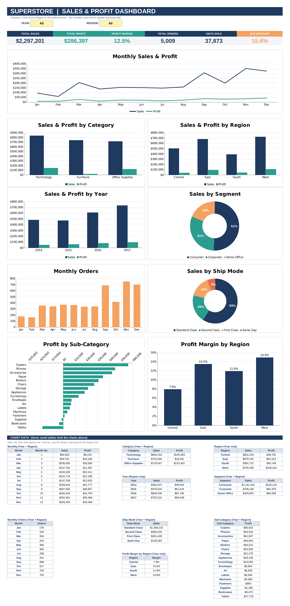
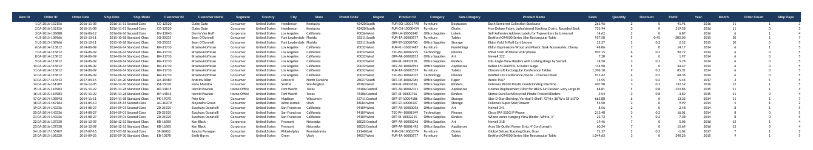
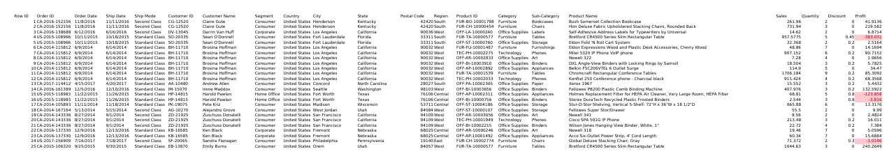
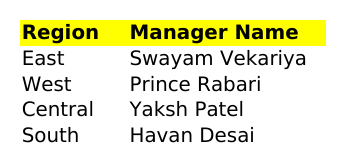
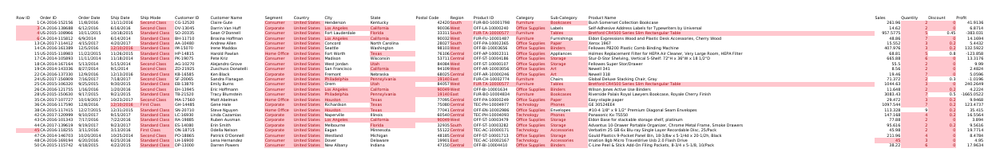
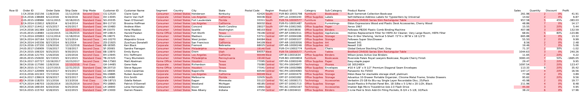
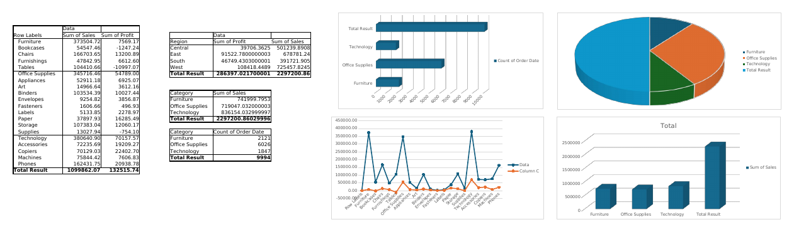
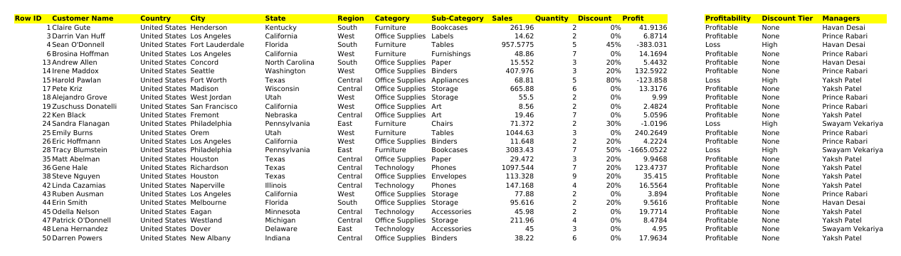

<div align="center">

# 📊 Superstore Sales & Profit Dashboard

**An interactive Microsoft Excel dashboard built on the Superstore sales dataset — filter by Year and Region and every KPI and chart updates instantly.**


</div>

---

## 📑 Table of Contents

- [Overview](#-overview)
- [Dashboard Preview](#-dashboard-preview)
- [Key Features](#-key-features)
- [KPIs & Charts](#-kpis--charts)
- [Workbook Structure](#-workbook-structure)
- [Sheet Screenshots](#-sheet-screenshots)
- [Sample Insights](#-sample-insights)
- [How It Works](#-how-it-works)
- [Getting Started](#-getting-started)
- [Repository Structure](#-repository-structure)
- [Skills Demonstrated](#-skills-demonstrated)
- [Author](#-author)

---

## 🔎 Overview

This project turns the raw **Superstore** retail sales data (9,994 order lines, 2014–2017, four US regions) into a clean, easy-to-read **Excel dashboard**.

The Dashboard sheet is intentionally simple and self-contained:

- Two **dropdown filters** (Year and Region) control everything on the page.
- Six **KPI cards** summarise the business at a glance.
- Nine **charts** show trends, comparisons and shares.
- Small **chart-data tables** at the bottom of the same sheet feed the charts, using plain `SUMIFS` formulas straight from the `Data` sheet — no hidden helper sheet.

The workbook also contains the supporting analysis sheets (`Q.1` – `Q.5`) with duplicate checks, pivot tables, and a profitability / discount-tier / regional-manager lookup.

---

## 🖼️ Dashboard Preview

<p align="center">
  
</p>

---

## ✨ Key Features

| Feature | Description |
|---|---|
| **Interactive filters** | Year (`All, 2014–2017`) and Region (`All, Central, East, South, West`) dropdowns with data validation |
| **Live KPI cards** | Total Sales, Total Profit, Profit Margin, Total Orders, Units Sold, Avg Discount |
| **9 charts** | Line, clustered column, bar and doughnut charts in a consistent navy / teal / orange theme |
| **Formula-driven** | Every number is a formula — change a filter and everything recalculates |
| **Self-contained** | No macros, no VBA, no external links, no hidden analysis sheet |
| **Clean layout** | Gridlines off, aligned card grid, readable fonts and number formats |

---

## 📈 KPIs & Charts

### KPI cards

| KPI | Logic |
|---|---|
| **Total Sales** | `SUMIFS` of Sales for the selected Year / Region |
| **Total Profit** | `SUMIFS` of Profit for the selected Year / Region |
| **Profit Margin** | Total Profit ÷ Total Sales |
| **Total Orders** | Distinct orders, using a helper flag column on the `Data` sheet |
| **Units Sold** | `SUMIFS` of Quantity |
| **Avg Discount** | `AVERAGEIFS` of Discount |

### Charts

| # | Chart | Type | Responds to |
|---|---|---|---|
| 1 | Monthly Sales & Profit | Line | Year + Region |
| 2 | Sales & Profit by Category | Clustered column | Year + Region |
| 3 | Sales & Profit by Region | Clustered column | Year only |
| 4 | Sales & Profit by Year | Clustered column | Region only |
| 5 | Sales by Segment | Doughnut | Year + Region |
| 6 | Monthly Orders | Column | Year + Region |
| 7 | Sales by Ship Mode | Doughnut | Year + Region |
| 8 | Profit by Sub-Category | Horizontal bar | Year + Region |
| 9 | Profit Margin by Region | Column | Year only |

> The *Year* chart ignores the Year filter and the *Region* charts ignore the Region filter — otherwise they would show a single bar.

---

## 🗂️ Workbook Structure

| Sheet | Purpose |
|---|---|
| **Dashboard** | The interactive dashboard: filters, KPI cards, 9 charts and the chart-data tables |
| **Data** | Cleaned dataset used by the dashboard, with helper columns: `Year`, `Month`, `Order Count`, `Ship Days` |
| **Superstore Dataset** | Original raw dataset (hidden sheet) |
| **Managers** | Region → Manager lookup table |
| **Q.1** | Unique orders (5,009 rows) — one line per Order ID |
| **Q.2** | Duplicate-value check using conditional formatting |
| **Q.3 & Q.5** | Pivot tables and pivot charts: sales and profit by category / sub-category / region, order counts |
| **Q.4** | Adds `Profitability`, `Discount Tier` and `Managers` columns using `IF` and `VLOOKUP` |

---

## 📸 Sheet Screenshots

> Screenshots show the first rows of each sheet. Large data sheets are truncated for readability.

### 1. Dashboard


### 2. Data
Cleaned dataset with the helper columns used by the dashboard formulas.



### 3. Superstore Dataset (raw)


### 4. Managers


### 5. Q.1 — Unique Orders


### 6. Q.2 — Duplicate Check


### 7. Q.3 & Q.5 — Pivot Tables & Pivot Charts


### 8. Q.4 — Profitability, Discount Tier & Manager


---

## 💡 Sample Insights

*(With Year = All and Region = All)*

- **Total sales ≈ $2.30M** and **total profit ≈ $286K**, a **12.5%** overall profit margin.
- **Technology** is the top category by sales (~$836K) and by profit (~$145K).
- **Furniture** sells almost as much as Office Supplies but earns a very thin margin (~2.5%).
- **West** has the highest sales and margin (14.9%); **Central** has the weakest margin (7.9%).
- **Copiers** and **Phones** are the most profitable sub-categories, while **Tables**, **Bookcases** and **Supplies** lose money.
- Orders peak in **September – December**, with November the busiest month.
- Most sales come through **Standard Class** shipping (~59%).

---

## ⚙️ How It Works

Each KPI and chart-data cell is a simple `SUMIFS` that reads the filters directly from the dashboard. When a filter is set to **All**, the formula switches its criteria to `"<>"`, which matches every row:

```excel
=SUMIFS(Data!$R$2:$R$9995,
        Data!$V$2:$V$9995, IF($C$4="All","<>",$C$4),   -- Year filter
        Data!$M$2:$M$9995, IF($F$4="All","<>",$F$4))   -- Region filter
```

Other formulas used:

```excel
Profit Margin   =IFERROR(D7/B7,0)
Avg Discount    =IFERROR(AVERAGEIFS(Data!$T$2:$T$9995, ...),0)
Discount Tier   =IF([@Discount]>0.2,"High",IF([@Discount]>0,"Low","None"))
Manager lookup  =VLOOKUP([@Region],Managers!A2:B5,2,FALSE)
```

---

## 🚀 Getting Started

1. **Download** or clone this repository:
   ```bash
   git clone https://github.com/<your-username>/<your-repo-name>.git
   ```
2. **Open** `YakshPatel_ExcelDashboard.xlsx` in **Microsoft Excel** (2016 or later recommended).
3. Go to the **Dashboard** sheet.
4. Use the yellow **Year** and **Region** dropdowns to explore the data.

> 💡 If the numbers show as zero after opening, press **Ctrl + Alt + F9** to force a full recalculation, and enable editing if Excel opened the file in Protected View.

---

## 📁 Repository Structure

```
.
├── README.md
├── YakshPatel_ExcelDashboard.xlsx
└── screenshots/
    ├── 01-dashboard.png
    ├── 02-data-sheet.png
    ├── 03-superstore-dataset.png
    ├── 04-managers.png
    ├── 05-q1-unique-orders.png
    ├── 06-q2-duplicate-check.png
    ├── 07-q3-q5-pivot-tables.png
    └── 08-q4-profitability-discount-manager.png
```

---

## 🧠 Skills Demonstrated

- Dashboard design and layout in Excel
- Conditional aggregation: `SUMIFS`, `AVERAGEIFS`, `IFERROR`, `IF`, `VLOOKUP`
- Data validation (dropdown filters)
- Pivot tables and pivot charts
- Data cleaning: duplicate detection, helper columns, Excel Tables
- Data visualisation: line, column, bar and doughnut charts
- KPI design and business storytelling

---

## 👤 Author

**Yaksh Patel**

- GitHub: [@Yaksh-Codes](https://github.com/Yaksh-Codes)
- LinkedIn: [@Yaksh19](https://www.linkedin.com/in/Yaksh19)

---

## 📄 License

This project is for learning and portfolio purposes. The Superstore dataset is a publicly available sample dataset.

<div align="center">

⭐ If you found this project useful, please consider giving it a star!

</div>
